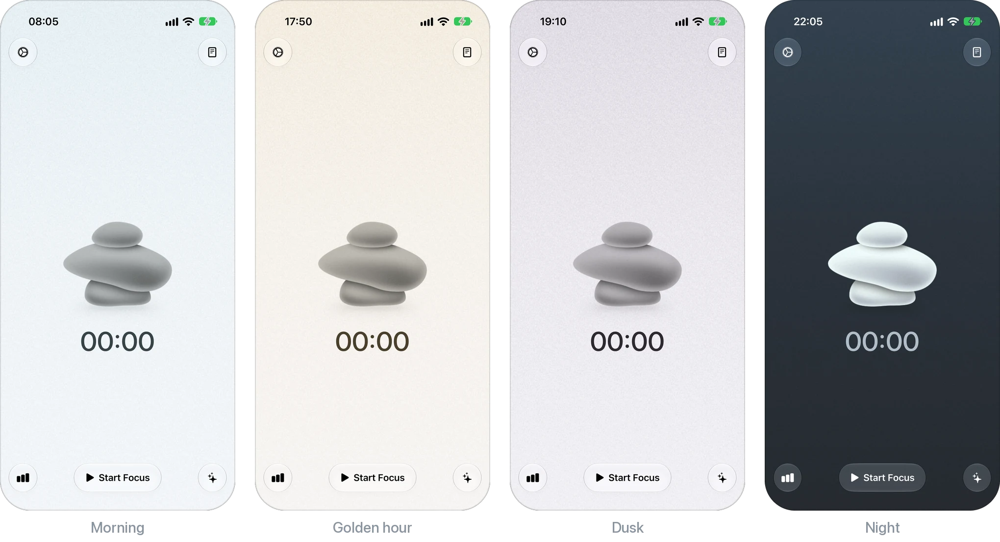
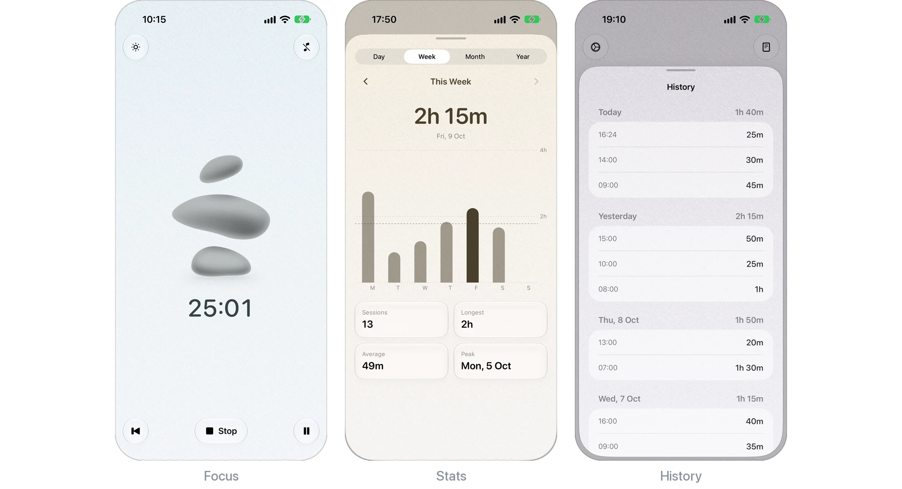

  

<h1 align="center">Wiser</h1>

  A calm focus timer for iOS, with a sky that follows your day.

  

## Features

- **Focus timer.** Start, pause, resume and stop. A running session survives the app being closed, and every session of five minutes or more is saved.
- **A sky that follows your day.** The background follows the real sunrise and sunset where you are, moving through soft Japanese traditional colors, and turns muted on cloudy or rainy days.
- **Stacking stones.** The stones rise while you focus, tilt when you pause and settle when you're done.
- **Stats.** Focus time by day, week, month or year, with a daily average and a comparison with the period before. Tap any bar to see its total.
- **History.** Every session, grouped by day.

  

## Requirements

- iOS 26.2 or later
- Xcode 26 or later
- An Apple Developer Program membership, for WeatherKit

## Building

1. Open `Wiser.xcodeproj`.
2. Under **Signing & Capabilities**, pick your team and change the bundle identifier.
3. On the Apple Developer website, turn on WeatherKit under App Services for that App ID. Without it the app still works, but the sky uses fixed sunrise and sunset times and ignores the weather.
4. Build and run.

## Built with

SwiftUI, SwiftData, Swift Charts, WeatherKit, Core Location and a small Metal shader.
